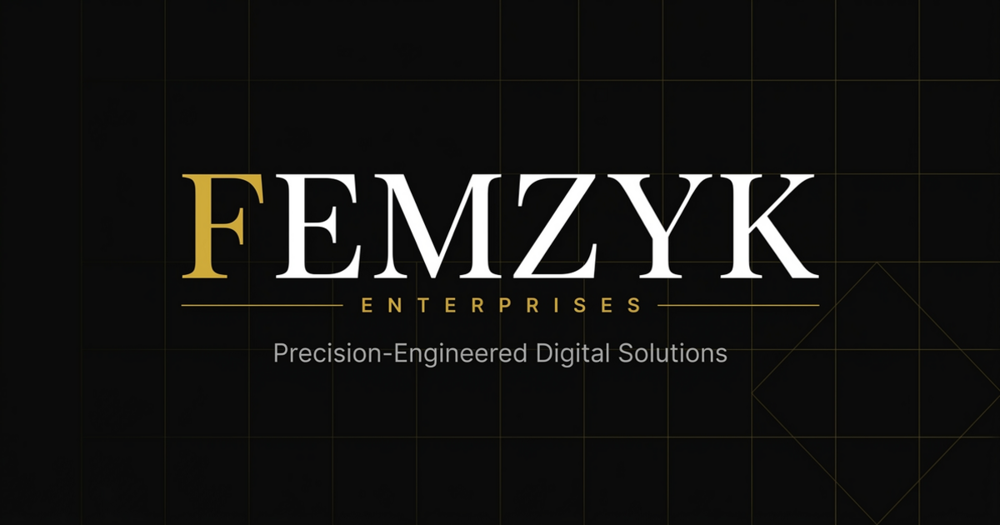

<div align="center">
  

# KERIFEM DIGITAL VENTURES

**Digital solutions. Intelligent systems. Real-world impact.**


[Selected work](#selected-work) · [Run locally](#run-locally) · [Deploy](#deploy) · [Contact](#contact)

</div>

Kerifem builds software, websites and connected workflows for businesses, education providers and teams worldwide. This repository contains the corporate website, public portfolio and quote-request flow.

**Business identity:** KERIFEM DIGITAL VENTURES is the CAC-registered business name. FEMZYK originated in 2023 and remains part of our project and brand history. The separate SMEDAN record uses **FEMZYK ENTERPRISES LTD**. This distinction does not establish a corporate ownership relationship.

## Website preview

Real captures from the local production build:

| Desktop | Mobile |
| --- | --- |
|  |  |

## Services

| Capability | Typical scope |
| --- | --- |
| Software development | Custom desktop and web applications, internal tools and maintenance |
| Web development | Websites, commerce, WordPress and technical SEO |
| AI integration | Model API prototypes, document processing and human review |
| API engineering and automation | REST APIs, databases, webhooks and business workflows |
| Graphics and digital design | Branding materials, campaign creatives and UI design |
| Writing and documentation | Editing, reports, software writing and handover guides |
| Technology training | Programming, databases, APIs and practical project guidance |

Focused engagements start at **$100 USD**. **$100–$10,000+** is an indicative range, not a ceiling. Quotes depend on scope, complexity and delivery requirements.

## Selected work

| Project | Evidence checked | What it demonstrates |
| --- | --- | --- |
| [Knowledge Land CBT Suite](https://github.com/FEMZYKENTLTD/klc-exam-portal) | README, exam controllers, scoring utility, repository screenshots | Java/JavaFX examination and administration workflows |
| [FEMZYK Fleet & Transport Management](https://github.com/FEMZYKENTLTD/FEMZYK-Enterprise-Fleet-and-Transport-Management-System) | Release screenshots and Java application source | Fleet operations dashboards and reporting |
| [ResumeRank](https://github.com/FEMZYKENTLTD/Resume-Screening-Classifier) | README, scoring source, Streamlit dashboard and API files | Python document processing and weighted keyword review; not automated hiring |
| [Contact Book Pro](https://github.com/FEMZYKENTLTD/Contact_Book_Pro) | Go application, storage code and UI captures | Contact entry, search and recovery |
| [Stock Analysis JavaFX App](https://github.com/FEMZYKENTLTD/stock-analysis-javafx) | JavaFX source and five application captures | Interactive calculations on manually entered prices |

The portfolio features 16 genuine application screenshots across these five projects. See [asset provenance](public/projects/README.txt). The Fleet project’s separate web edition is linked from its case study; the publicly accessible landing page was verified, not its authenticated workflows. FEMZYK MARKET is excluded from the featured gallery because the inspected checkout had no suitable UI capture. The About page summarises the separately reviewed CAC and SMEDAN documents using redacted images of the supplied certificates; the original PDFs and sensitive details are not published.

## Architecture

```text
Next.js App Router → static corporate and legal pages
                  → /contact → React Hook Form + shared Zod schema
                             → POST /api/enquiry → Web3Forms → business inbox
```

| Path | Responsibility |
| --- | --- |
| `app/` | Routes, page metadata, sitemap, robots and the enquiry handler |
| `components/` | Shared corporate presentation, form UI and legal layout |
| `lib/corporate.ts` | Service and project presentation data |
| `lib/enquiry.ts` | Shared validation contract |
| `lib/site.ts` | Brand, approved contact details and canonical origin |
| `public/` | Brand artwork, social card and portfolio assets |
| `scripts/` | Local route and enquiry smoke checks |

## Run locally

Use Node.js 22 and npm. The site uses Next.js App Router, React 19, strict TypeScript, Tailwind CSS 3, Lucide, React Hook Form and Zod.

```sh
npm ci
cp .env.example .env.local
npm run dev
```

Open <http://localhost:3000>. For a production-style local check:

```sh
npm run lint
npm run typecheck
npm run format:check
npm run build
npm run start
# In another terminal, against an unconfigured server:
npm run test:smoke -- --unconfigured
```

## Contact form setup

| Environment variable | Scope | Setup |
| --- | --- | --- |
| `WEB3FORMS_ACCESS_KEY` | Server only | Create an access key for the approved business inbox and store it in `.env.local` or the hosting dashboard. Replace any prior `NEXT_PUBLIC_WEB3FORMS_ACCESS_KEY` deployment setting; rotate a previously public key as appropriate. |
| `NEXT_PUBLIC_SITE_URL` | Public | Override the production HTTPS origin if the public domain changes. The existing Vercel production domain is the default; leave blank for local development. |

The quote form includes country, a project title and reference URL where applicable, a USD budget range and delivery timeline. The server accepts bounded JSON, validates it again, rejects honeypot entries and cross-site browser POSTs, and times out the provider call. Success means Web3Forms accepted the submission; inbox delivery is a separate check. On failure, the form retains the visitor’s details and shows direct contact alternatives. No site database is used.

**Why not Supabase?** No eligible project was visible in the connected account, and inbox delivery does not require an enquiry database. Using Web3Forms avoids adding a database, access policies, retention jobs and a separate email sender. Confirm the provider's current terms, quotas and retention before launch. Enable platform-level rate limiting for `/api/enquiry` where available; the honeypot and provider filtering are not a distributed rate limiter. Do not add enquiry payloads to logs or ask visitors for passwords or sensitive records.

## Deploy

1. Import `FEMZYKENTLTD/KERIFEM-DIGITAL-VENTURES` into a Vercel plan suitable for commercial use. Select **Next.js**, repository root, Node.js 22 and the default build output. Use `npm ci` and `npm run build` if overriding the defaults.
2. Review the working branch in a Preview deployment. Keep production credentials out of previews unless the recipient is expecting test submissions. Do not run the smoke script against configured deployments.
3. Review legal copy and project image permissions, assign the production branch and confirm the actual production domain. Set both environment variables for Production and redeploy.
4. Visit the production URL; check navigation, metadata, social image, robots and sitemap. Send a clearly labelled test enquiry and confirm receipt at the intended inbox. A successful build alone does not verify delivery.

The site emits page descriptions, Open Graph and X cards, and Organization structured data. Canonicals and sitemap entries are emitted for the declared production origin; previews and unconfigured installations are non-indexable.

## Maintenance and release review

Keep service claims tied to demonstrable capability and list a demo only after checking the public URL. Cite source screenshots and label conceptual art. Review legal drafts for registration wording, inbox retention and the selected hosting provider. Review dependency advisories before launch; the pinned Next.js 15 and Zod 3 stacks currently have advisories whose reported fixes involve major upgrades. Re-run the checks above after changing the enquiry contract or deployment settings.

## Contact

- Primary email: [femzykenterprisesltd@gmail.com](mailto:femzykenterprisesltd@gmail.com)
- Alternate email: [femzykentltd@gmail.com](mailto:femzykentltd@gmail.com)
- WhatsApp: [+234 902 115 6310](https://wa.me/2349021156310) · [+234 904 990 3679](https://wa.me/2349049903679)
- [GitHub](https://github.com/FEMZYKENTLTD) · [X](https://x.com/KeripeOluf1604)
