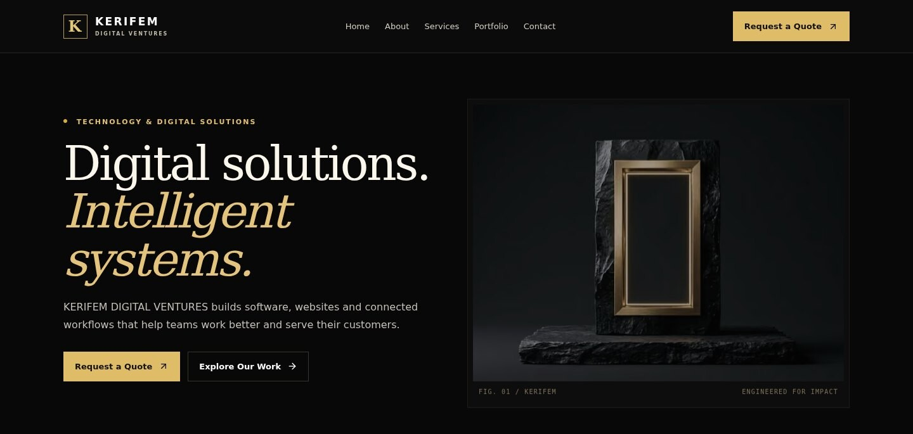
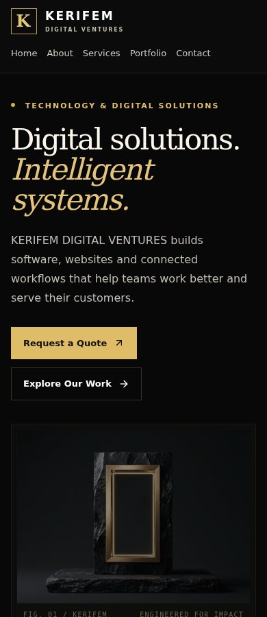
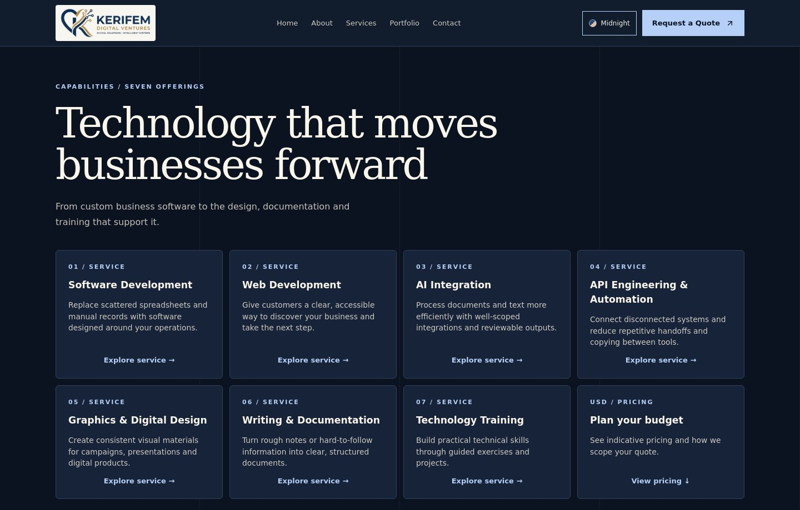
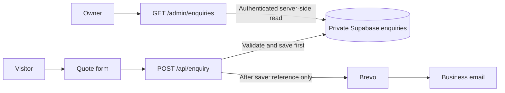

<div align="center">
  

# KERIFEM DIGITAL VENTURES

**Digital solutions. Intelligent systems. Real-world impact.**


[Website preview](#website-preview) · [Services](#services) · [Portfolio](#selected-work) · [Architecture](#architecture) · [Setup](#run-locally) · [Release checklist](#release-checklist) · [Contact](#contact)

</div>

Kerifem builds software, websites and connected workflows for businesses, education providers and teams worldwide. This repository contains the corporate website, public portfolio and quote-request flow.

**Business identity:** KERIFEM DIGITAL VENTURES is the CAC-registered business name. FEMZYK originated in 2023 and remains part of our project and brand history. The separate SMEDAN record uses **FEMZYK ENTERPRISES LTD**. This distinction does not establish a corporate ownership relationship.

---

## Engineering highlights

| Feature | Engineering decision |
| --- | --- |
| Public site search | The guide ranks passages from the same public content modules the site renders, links to source pages, and falls back when it has no good match. No external model or transcript storage is required. |
| Private quote receipts | Nine budget-specific routes display the submitted details in memory only. Refreshing or sharing the URL does not reveal the submission. |
| Enquiry workflow | Validate on the server and save first; notify second. A failed email does not discard a saved enquiry. |
| Owner workspace | Supabase Auth protects enquiry management, while server-only queries handle pagination, aggregate charts, and email retries. |
| Quality checks | The repository includes automated formatting, lint, build, type, and search regression checks. The search suite checks coverage against the public route inventory. |

## At a glance

- **Public site:** seven dedicated service pages, five portfolio case studies, an About page, and a quote form with service preselection.
- **Design:** Midnight blue by default, optional black-and-gold Obsidian, and a full-size founder portrait link.
- **Enquiry operations:** validated submissions go to a private database; Brevo sends reference-only email alerts. A missed email does not erase a saved enquiry.
- **Measurement:** Vercel Web Analytics and Speed Insights run on Vercel production deployments when enabled. A merged change is not evidence of a live deployment or successful delivery.

## Website preview

Browser captures using the default **Midnight blue** palette. The homepage captures predate the latest founder portrait.

<div align="center">

| Desktop homepage · 1440 × 960 | Mobile homepage · 390 × 844 |
| --- | --- |
|  |  |

<details>
<summary><strong>Explore the Services overview</strong></summary>
<br />

</details>

</div>

## Services

| Capability | Typical scope |
| --- | --- |
| Software development | Custom desktop and web applications, internal tools and maintenance |
| Web development | Websites, commerce, WordPress and technical SEO |
| AI integration | Model API prototypes, document processing and human review |
| API engineering and automation | REST APIs, databases, webhooks and business workflows |
| Graphics and digital design | Branding materials, campaign creatives and UI design |
| Writing and documentation | Editing, reports, software writing and handover guides |
| Technology training | Programming, databases, APIs and practical project guidance |

Focused engagements start at **$100 USD**. **$100–$10,000+** is an indicative range, not a ceiling. Quotes depend on scope, complexity and delivery requirements.

## Selected work

| Project | Evidence checked | What it demonstrates |
| --- | --- | --- |
| [Knowledge Land CBT Suite](https://github.com/FEMZYKENTLTD/klc-exam-portal) | README, exam controllers, scoring utility, repository screenshots | Java/JavaFX examination and administration workflows |
| [FEMZYK Fleet & Transport Management](https://github.com/FEMZYKENTLTD/FEMZYK-Enterprise-Fleet-and-Transport-Management-System) | Release screenshots and Java application source | Fleet operations dashboards and reporting |
| [ResumeRank](https://github.com/FEMZYKENTLTD/Resume-Screening-Classifier) | README, scoring source, Streamlit dashboard and API files | Python document processing and weighted keyword review; not automated hiring |
| [Stock Analysis JavaFX App](https://github.com/FEMZYKENTLTD/stock-analysis-javafx) | JavaFX source and five application captures | Interactive calculations on manually entered prices |

The portfolio features 16 genuine application screenshots across the published case studies. See [asset provenance](public/projects/README.txt). The Fleet project’s separate web edition is linked from its case study; the publicly accessible landing page was verified, not its authenticated workflows. FEMZYK MARKET is excluded from the featured gallery because the inspected checkout had no suitable UI capture. The About page summarises the separately reviewed CAC and SMEDAN documents using redacted images of the supplied certificates; the original PDFs and sensitive details are not published.

---

## Architecture



| Route | Purpose |
| --- | --- |
| `/services`, `/services/[service]` | Services overview and dedicated scope, workflow, and deliverables |
| `/portfolio`, `/portfolio/[project]` | Project index and screenshot-backed case studies |
| `/contact?service=web` | Quote form with an optional preselected service |
| `POST /api/enquiry` | Validate and save enquiries, then attempt an email alert |
| `/admin/enquiries` | Owner-only inbox, newest first, with pagination and notification status |

| Path | Responsibility |
| --- | --- |
| `app/` | Routes, page metadata, sitemap, robots and the enquiry handler |
| `components/` | Shared corporate presentation, form UI and legal layout |
| `lib/corporate.ts` | Service and project presentation data |
| `lib/enquiry.ts` | Shared validation contract |
| `lib/enquiry-store.ts` | Server-side database and notification calls |
| `supabase/enquiries.sql` | Enquiry table, index, row-level security and grants |
| `lib/site.ts` | Brand, approved contact details and canonical origin |
| `public/` | Brand artwork, social card and portfolio assets |
| `scripts/` | Local route and enquiry smoke checks |

---

## Run locally

Use Node.js 22 and npm. The site uses Next.js App Router, React 19, strict TypeScript, Tailwind CSS 3, Lucide, React Hook Form and Zod.

```sh
npm ci
cp .env.example .env.local
npm run dev
```

Open <http://localhost:3000>. For a production-style local check:

```sh
npm run lint
npm run test:guide
npm run typecheck
npm run format:check
npm run build
npm run start
# In another terminal, against an unconfigured server:
npm run test:smoke -- --unconfigured
```

## Enquiry inbox setup

| Environment variable | Scope | Setup |
| --- | --- | --- |
| `SUPABASE_URL`, `SUPABASE_SERVICE_ROLE_KEY` | Server only | Apply `supabase/enquiries.sql` in the intended project, then configure its URL and legacy service-role key. |
| `SUPABASE_PUBLISHABLE_KEY` | Auth configuration | The Supabase publishable key (or legacy `anon` key), from the same project. This does not replace the private service-role key. |
| `BREVO_API_KEY` | Server only | Brevo API key for transactional email; not the SMTP key used in Supabase Auth. |
| `BREVO_SENDER_EMAIL` | Server configuration | Sender email verified in Brevo. Alerts go to the primary business inbox. Only the reference is sent. |
| `NEXT_PUBLIC_SITE_URL` | Public | Override the production HTTPS origin if needed. |

### Set up a preview first

1. For a **new** Supabase project, apply [`supabase/enquiries.sql`](supabase/enquiries.sql) once. Skip this step for an existing project where the migration has already been applied.
2. Add the variables above to your deployment's **Preview** environment and redeploy the branch. Use separate test credentials where possible. Never add a secret to Git, chat, public environment variables, or build logs.
3. Provision the owner account using the instructions below. Open **Admin sign in** in the footer or go to `/admin/sign-in` over HTTPS.
4. Submit a clearly labelled test quote. Verify the saved record in the private inbox, then check the actual business email inbox for the matching reference. **No Resend account or custom domain is required.**

### Provision the admin account and recovery

1. For an existing database, run [`supabase/enquiry-admin.sql`](supabase/enquiry-admin.sql) once to permit owner-initiated deletes through the server. Existing enquiries are not moved or modified.
2. In Supabase **Authentication → Users**, create or confirm the site owner's account (`femzykenterprisesltd@gmail.com`). Use a unique initial password, stored privately, and disable public sign-ups for this dedicated project. Only the confirmed owner email is authorised by the app.
3. In **Authentication → URL Configuration**, set the site URL and allow the exact `/admin/callback` URL. It must match the origin configured in `NEXT_PUBLIC_SITE_URL` for the deployment under test. Avoid wildcard redirect URLs. A preview that points at the production origin cannot complete its own recovery flow.
4. Configure Supabase Auth **custom SMTP** and test the reset email. Password recovery uses Supabase Auth SMTP. Quote alerts use the Brevo transactional API and are configured separately. After deploying the new recovery route, replace the link in **Authentication → Emails → Templates → Reset password** with `<a href="{{ .SiteURL }}/admin/recover?token_hash={{ .TokenHash }}">Reset password</a>`. Set Site URL to the production website origin (no trailing slash). Turn off email link tracking for reset emails if it is enabled. Request a fresh email and click **Continue to password reset** before choosing a password. The new link is verified only on confirmation, not on page load, and does not rely on the original browser's PKCE cookie. The legacy `/admin/callback` remains available for old links.
5. Verify the new sign-in, password change and recovery on the target environment before switching production. Remove the unused `ENQUIRY_ADMIN_PASSWORD` only after verification. Set platform rate limits on the admin and enquiry endpoints.

The dashboard lists 25 records per page with server-side search and filters. Owners can create, view, edit and permanently delete records. Manual additions and edits do not trigger an email. Search terms appear in the private dashboard URL, so don't paste confidential project text into search.

### Troubleshooting

| Symptom | What to check |
| --- | --- |
| Quote form returns `503 FORM_NOT_CONFIGURED` | Confirm the Supabase URL and server key are set for this deployment, then redeploy. |
| Quote form returns `502 PROVIDER_UNAVAILABLE` | The save could not be confirmed. Check the database configuration and whether a record exists before retrying. |
| Admin sign-in fails | Confirm the publishable key, confirmed owner user, and password. The old `owner` / `ENQUIRY_ADMIN_PASSWORD` sign-in is no longer used. |
| Notification is `not_configured` or `failed` | The enquiry is saved. Check the Brevo API key, verified sender, and transactional logs. |
| Notification is `accepted`, but no email arrived | Brevo accepted the alert; this does not confirm delivery. Check the destination mailbox and spam folder. |
| Notification remains `pending` | The save completed, but the final notification status was not recorded. Check server diagnostics and the inbox. |

The form enforces shared validation, a request-size limit, a honeypot and a cross-site browser request check. These are not distributed rate limits. There is no automatic email retry or historical inbox import. Keep the legacy form working until the preview passes both checks.

## Release checklist

- [ ] Configure the correct repository, Node.js 22, and Next.js build settings on a hosting plan suitable for commercial use.
- [ ] Pass lint, type checking, formatting, production build and the unconfigured smoke test locally. Do not run the smoke test against a configured deployment.
- [ ] Verify public routes, the mobile layout, theme switching, and the founder portrait link on a preview.
- [ ] Verify an unauthenticated visitor cannot read the inbox. Verify one test submission is both saved and emailed on the preview.
- [ ] Configure production-only settings, HTTPS, rate limits for `/api/enquiry` and `/admin/enquiries`, and a retention policy. Rotate previously exposed keys. Never log enquiry payloads.
- [ ] Review the legal drafts and screenshot permissions. Feature only evidenced work and distinguish simulations and learning projects from live products.
- [ ] After deploying, verify the canonical origin, social cards, robots, sitemap, and a labelled production quote that appears in both inboxes.

### Production measurement

Enable **Web Analytics** and **Speed Insights** in the Vercel project dashboard. The application mounts both only when `VERCEL_ENV=production` and strips query strings and fragments from event page URLs. After deployment, visit a few pages and verify traffic and performance samples in the respective dashboards. Local and preview visits are not collected by this setup.

---

## Contributing changes

Keep public claims tied to the site's published content or to evidence in the portfolio. When adding a public information route, update [`lib/public-pages.ts`](lib/public-pages.ts) and its search entry in [`lib/guide-search.ts`](lib/guide-search.ts), then run `npm run test:guide`. Keep the admin area and customer-specific receipts out of the search and sitemap. The [verification workflow](.github/workflows/verify.yml) does not need deployment secrets and cannot verify live email delivery.

## Contact

- Primary email: [femzykenterprisesltd@gmail.com](mailto:femzykenterprisesltd@gmail.com)
- Alternate email: [femzykentltd@gmail.com](mailto:femzykentltd@gmail.com)
- WhatsApp: [+234 902 115 6310](https://wa.me/2349021156310) · [+234 904 990 3679](https://wa.me/2349049903679)
- [GitHub](https://github.com/FEMZYKENTLTD) · [X](https://x.com/KeripeOluf1604)

### Enquiry charts and site guide

- Apply [`supabase/enquiry-metrics.sql`](supabase/enquiry-metrics.sql) in the dedicated Supabase project to enable the dashboard charts. The server-only function returns aggregate service and budget counts and 30 UTC daily totals. The dashboard continues to list enquiries if the charts are unavailable.
- The public site guide searches the FAQ, service catalog, About content, portfolio case studies, policies, contact details, and quote workflow. It carries limited context in React memory only and has no external model, transcript storage, or training pipeline. It cannot access enquiries or the admin workspace. To improve answers across visits, add a reviewed question, non-sensitive matching phrases, and a source page to [`lib/guide-answers.ts`](lib/guide-answers.ts), then redeploy. Use recurring topics shared by support staff, not raw visitor chats.

### Password recovery and alert delivery

Supabase Auth handles password hashing and verification; the application does not store password hashes or plaintext passwords in the enquiry table. For the existing business Gmail account, if Google makes App Passwords available, enable two-step verification and create an app password for SMTP. In Supabase **Authentication → Email → SMTP settings**, use `smtp.gmail.com`, port `587` (STARTTLS), and the full Gmail address as both SMTP username and sender. Enter the app password directly in Supabase, never in Vercel, Git, or chat. If App Passwords are unavailable for this account, use an SMTP service you control. Test **Forgot password?** from the deployed admin sign-in page with the recovery template above.

Quote alerts are separate. Set `BREVO_API_KEY` and `BREVO_SENDER_EMAIL` in the deployment environment. The recipient is the primary business inbox; customer contact details never go to the notification provider. If Brevo API IP restrictions are enabled, confirm your hosting setup can satisfy them. Redeploy after changing it. The Vercel function logs show sanitized Brevo failure categories, not details or credentials. In the owner dashboard, use **Retry email alert** on a failed or unconfigured record, then check the mailbox and spam folder. A provider timeout is ambiguous, so an earlier alert may still arrive. The database remains the source of truth for the enquiry.

For Brevo, a verified sender is not necessarily compliant for delivery. If the only verified sender is a freemail address flagged as noncompliant, do not rely on it for recovery until a test reaches the owner inbox. If Brevo allows transactional sending with that sender, use `smtp-relay.brevo.com`, port `587`, the Brevo SMTP login and a dedicated Brevo SMTP key in Supabase. Use the verified sender shown in Brevo. Verify the received sender and delivery in Brevo transactional logs. If Brevo refuses or delivery fails, use an authenticated domain or another provider with an approved sending identity; keep Supabase dashboard account management available in the meantime.
