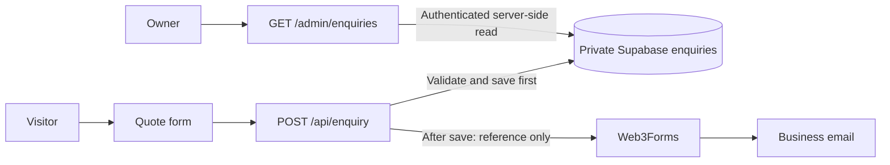

<div align="center">
  

# KERIFEM DIGITAL VENTURES

**Digital solutions. Intelligent systems. Real-world impact.**


[Website preview](#website-preview) · [Services](#services) · [Portfolio](#selected-work) · [Architecture](#architecture) · [Setup](#run-locally) · [Release checklist](#release-checklist)

</div>

Kerifem builds software, websites and connected workflows for businesses, education providers and teams worldwide. This repository contains the corporate website, public portfolio and quote-request flow.

**Business identity:** KERIFEM DIGITAL VENTURES is the CAC-registered business name. FEMZYK originated in 2023 and remains part of our project and brand history. The separate SMEDAN record uses **FEMZYK ENTERPRISES LTD**. This distinction does not establish a corporate ownership relationship.

## At a glance

- **Public site:** seven dedicated service pages, five portfolio case studies, an About page, and a quote form with service preselection.
- **Design:** Midnight blue by default, optional black-and-gold Obsidian, and a full-size founder portrait link.
- **Enquiry operations:** validated submissions go to a private database; Web3Forms sends reference-only email alerts. A missed email does not erase a saved enquiry.
- **Measurement:** Vercel Web Analytics and Speed Insights run on Vercel production deployments when enabled. A merged change is not evidence of a live deployment or successful delivery.

## Website preview

Archived captures from a local production build. These document an earlier layout; use a current branch preview to review the latest theme and navigation.

| Desktop | Mobile |
| --- | --- |
|  |  |

## Services

| Capability | Typical scope |
| --- | --- |
| Software development | Custom desktop and web applications, internal tools and maintenance |
| Web development | Websites, commerce, WordPress and technical SEO |
| AI integration | Model API prototypes, document processing and human review |
| API engineering and automation | REST APIs, databases, webhooks and business workflows |
| Graphics and digital design | Branding materials, campaign creatives and UI design |
| Writing and documentation | Editing, reports, software writing and handover guides |
| Technology training | Programming, databases, APIs and practical project guidance |

Focused engagements start at **$100 USD**. **$100–$10,000+** is an indicative range, not a ceiling. Quotes depend on scope, complexity and delivery requirements.

## Selected work

| Project | Evidence checked | What it demonstrates |
| --- | --- | --- |
| [Knowledge Land CBT Suite](https://github.com/FEMZYKENTLTD/klc-exam-portal) | README, exam controllers, scoring utility, repository screenshots | Java/JavaFX examination and administration workflows |
| [FEMZYK Fleet & Transport Management](https://github.com/FEMZYKENTLTD/FEMZYK-Enterprise-Fleet-and-Transport-Management-System) | Release screenshots and Java application source | Fleet operations dashboards and reporting |
| [ResumeRank](https://github.com/FEMZYKENTLTD/Resume-Screening-Classifier) | README, scoring source, Streamlit dashboard and API files | Python document processing and weighted keyword review; not automated hiring |
| [Contact Book Pro](https://github.com/FEMZYKENTLTD/Contact_Book_Pro) | Go application, storage code and UI captures | Contact entry, search and recovery |
| [Stock Analysis JavaFX App](https://github.com/FEMZYKENTLTD/stock-analysis-javafx) | JavaFX source and five application captures | Interactive calculations on manually entered prices |

The portfolio features 16 genuine application screenshots across these five projects. See [asset provenance](public/projects/README.txt). The Fleet project’s separate web edition is linked from its case study; the publicly accessible landing page was verified, not its authenticated workflows. FEMZYK MARKET is excluded from the featured gallery because the inspected checkout had no suitable UI capture. The About page summarises the separately reviewed CAC and SMEDAN documents using redacted images of the supplied certificates; the original PDFs and sensitive details are not published.

### Related repository

[NaijaSignal Pro](https://github.com/FEMZYKENTLTD/NaijaSignal-Pro) documents a cellular signal simulation project. It is separate from the five published case studies and is not evidence of measured network coverage or production deployment. [Contact Book Pro](https://github.com/FEMZYKENTLTD/Contact_Book_Pro) is already represented in the featured portfolio; its separate README covers the Go/Wails architecture and contact recovery workflow in more detail.

## Architecture



| Route | Purpose |
| --- | --- |
| `/services`, `/services/[service]` | Services overview and dedicated scope, workflow, and deliverables |
| `/portfolio`, `/portfolio/[project]` | Project index and screenshot-backed case studies |
| `/contact?service=web` | Quote form with an optional preselected service |
| `POST /api/enquiry` | Validate and save enquiries, then attempt an email alert |
| `/admin/enquiries` | Owner-only inbox, newest first, with pagination and notification status |

| Path | Responsibility |
| --- | --- |
| `app/` | Routes, page metadata, sitemap, robots and the enquiry handler |
| `components/` | Shared corporate presentation, form UI and legal layout |
| `lib/corporate.ts` | Service and project presentation data |
| `lib/enquiry.ts` | Shared validation contract |
| `lib/enquiry-store.ts` | Server-side database and notification calls |
| `supabase/enquiries.sql` | Enquiry table, index, row-level security and grants |
| `lib/site.ts` | Brand, approved contact details and canonical origin |
| `public/` | Brand artwork, social card and portfolio assets |
| `scripts/` | Local route and enquiry smoke checks |

## Run locally

Use Node.js 22 and npm. The site uses Next.js App Router, React 19, strict TypeScript, Tailwind CSS 3, Lucide, React Hook Form and Zod.

```sh
npm ci
cp .env.example .env.local
npm run dev
```

Open <http://localhost:3000>. For a production-style local check:

```sh
npm run lint
npm run typecheck
npm run format:check
npm run build
npm run start
# In another terminal, against an unconfigured server:
npm run test:smoke -- --unconfigured
```

## Contact form setup

| Environment variable | Scope | Setup |
| --- | --- | --- |
| `SUPABASE_URL`, `SUPABASE_SERVICE_ROLE_KEY` | Server only | Apply `supabase/enquiries.sql` in the intended project, then configure its URL and legacy service-role key. |
| `ENQUIRY_ADMIN_PASSWORD` | Server only | Generate a unique password of at least 24 random characters. Open `/admin/enquiries` over HTTPS and use username `owner`. |
| `WEB3FORMS_ACCESS_KEY` | Server only | Use the Web3Forms key linked to the business inbox. Only a reference number is sent; submission details stay in Supabase. |
| `NEXT_PUBLIC_SITE_URL` | Public | Override the production HTTPS origin if needed. |

### Set up a preview first

1. For a **new** Supabase project, apply [`supabase/enquiries.sql`](supabase/enquiries.sql) once. Skip this step for an existing project where the migration has already been applied.
2. Add the variables above to your deployment's **Preview** environment and redeploy the branch. Use separate test credentials where possible. Never add a secret to Git, chat, public environment variables, or build logs.
3. Open `/admin/enquiries` on the preview over HTTPS. Use username `owner` and the password configured for that environment. The inbox uses browser HTTP Basic authentication; avoid shared devices.
4. Submit a clearly labelled test quote. Verify the saved record in the private inbox, then check the actual business email inbox for the matching reference. **No Resend account or custom domain is required.**

### Troubleshooting

| Symptom | What to check |
| --- | --- |
| Quote form returns `503 FORM_NOT_CONFIGURED` | Confirm the Supabase URL and server key are set for this deployment, then redeploy. |
| Quote form returns `502 PROVIDER_UNAVAILABLE` | The save could not be confirmed. Check the database configuration and whether a record exists before retrying. |
| Admin returns `404` | The inbox is disabled unless the owner password is configured and at least 24 characters. |
| Notification is `not_configured` or `failed` | The enquiry is saved. Check the Web3Forms key and the inbox it is linked to. |
| Notification is `accepted`, but no email arrived | Web3Forms accepted the alert; this does not confirm delivery. Check the destination mailbox and spam folder. |
| Notification remains `pending` | The save completed, but the final notification status was not recorded. Check server diagnostics and the inbox. |

The form enforces shared validation, a request-size limit, a honeypot and a cross-site browser request check. These are not distributed rate limits. There is no automatic email retry or historical inbox import. Keep the legacy form working until the preview passes both checks.

## Release checklist

- [ ] Configure the correct repository, Node.js 22, and Next.js build settings on a hosting plan suitable for commercial use.
- [ ] Pass lint, type checking, formatting, production build and the unconfigured smoke test locally. Do not run the smoke test against a configured deployment.
- [ ] Verify public routes, the mobile layout, theme switching, and the founder portrait link on a preview.
- [ ] Verify an unauthenticated visitor cannot read the inbox. Verify one test submission is both saved and emailed on the preview.
- [ ] Configure production-only settings, HTTPS, rate limits for `/api/enquiry` and `/admin/enquiries`, and a retention policy. Rotate previously exposed keys. Never log enquiry payloads.
- [ ] Review the legal drafts and screenshot permissions. Feature only evidenced work and distinguish simulations and learning projects from live products.
- [ ] After deploying, verify the canonical origin, social cards, robots, sitemap, and a labelled production quote that appears in both inboxes.

### Production measurement

Enable **Web Analytics** and **Speed Insights** in the Vercel project dashboard. The application mounts both only when `VERCEL_ENV=production` and strips query strings and fragments from event page URLs. After deployment, visit a few pages and verify traffic and performance samples in the respective dashboards. Local and preview visits are not collected by this setup.

## Contact

- Primary email: [femzykenterprisesltd@gmail.com](mailto:femzykenterprisesltd@gmail.com)
- Alternate email: [femzykentltd@gmail.com](mailto:femzykentltd@gmail.com)
- WhatsApp: [+234 902 115 6310](https://wa.me/2349021156310) · [+234 904 990 3679](https://wa.me/2349049903679)
- [GitHub](https://github.com/FEMZYKENTLTD) · [X](https://x.com/KeripeOluf1604)
